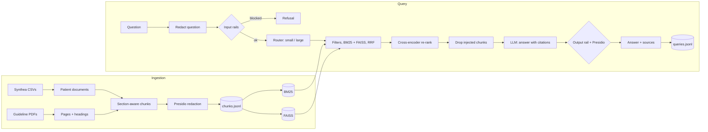

# Safe clinical RAG assistant

A question-answering assistant over **synthetic** patient records ([Synthea](https://github.com/synthetichealth/synthea)) and public VA/DoD clinical practice guidelines. It answers only from its sources and cites them, never shows patient identifiers, refuses individual diagnosis or treatment advice, routes questions between a small and a large model, and every claim about its quality comes from a reproducible evaluation.

No real patient data is used anywhere.

## What it does

- **PHI redaction before indexing.** Presidio with spaCy `en_core_web_lg` plus custom recognizers for Synthea's numbered names, record UUIDs, SSN, licence and passport numbers, addresses and dates of birth. A leak scan checks every identifier in `patients.csv` against the indexed text: **0 leaks in 6,485 chunks**, with or without the name deny-list ([redaction report](reports/redaction_report.md)).
- **Hybrid retrieval.** BM25 + FAISS (bge-small-en-v1.5) fused with reciprocal rank fusion, metadata filters (document type, patient, date range) applied before fusion, and a bge-reranker-base cross-encoder ([comparison](reports/retrieval_comparison.md)).
- **Grounded generation with model tiering.** The answer prompt allows only the retrieved context, wrapped in delimiters as data, and every fact must cite a `[chunk_id]`. A router sends each question to a small or a large model; three routers (rules, rules + LLM classifier, trained logistic regression) are compared head to head ([router report](reports/router_comparison.md)).
- **Guardrails.** NeMo Guardrails input rails (prompt injection, identity reveal, individual advice, off-topic) and an output rail that blocks any identifier in an answer. Retrieved chunks that look like prompt injection are dropped before generation ([guardrails report](reports/guardrails_report.md)).
- **Evaluation harness.** A 98-item golden set (lookups, multi-hop, unanswerable), five configurations, judge-free retrieval and answer metrics, RAGAS on a fixed subset, paired bootstrap confidence intervals and a regression check ([evaluation report](eval/REPORT.md)). Only one configuration has been run so far (see below).
- **Telemetry.** Every query is logged to `logs/queries.jsonl` (redacted question, route and reason, per-stage latency, tokens, estimated cost, guardrail status).

## Architecture



## Run it

Python 3.11, CPU only. Java 17+ is needed only to generate the Synthea population.

```bash
python3.11 -m venv .venv && source .venv/bin/activate   # Windows: py -3.11 -m venv .venv; .venv\Scripts\activate
pip install -r requirements.txt
cp .env.example .env   # set PATIENT_ID_SALT and the LLM endpoints
```

| Step | make | plain command |
|---|---|---|
| Download / generate data | `make data` | `python -m scripts.get_synthea && python -m scripts.get_synthea_sample && python -m scripts.get_guidelines` |
| Chunk + redact + leak scan | `make ingest` | `python -m healthrag.ingest` |
| Build the FAISS index | `make index` | `python -m scripts.build_index` |
| Ask a question | `make ask Q="..."` | `python -m healthrag.ask "..." [--patient ID]` |
| API | `make api` | `uvicorn healthrag.api:app --port 8000` |
| UI | `make ui` | `streamlit run ui/app.py` |
| Tests (offline) | `make test` | `python -m pytest -q` |
| Evaluation | `make eval-run eval-ragas eval-report` | `python -m eval.run`, `python -m eval.ragas_run`, `python -m eval.report` |
| Regression check | `make eval` | `python -m eval.regress` |

Evaluation extras (RAGAS, which pulls in LangChain) live in `requirements-eval.txt`; the app never imports LangChain.

Docker: `docker compose up` starts the API (:8000) and the UI (:8501) using the data and index built on the host; `--profile ollama` adds a local Ollama for the small tier.

## Models

| Role | Model | Where |
|---|---|---|
| Small tier | `openai/gpt-oss-20b` | Groq (OpenAI-compatible) |
| Large tier | `openai/gpt-oss-120b` | Groq (Azure OpenAI switch available) |
| RAGAS judge | `qwen/qwen3.8-27b` | Groq, a different family from the large model |
| Embeddings | `BAAI/bge-small-en-v1.5` | local CPU |
| Re-ranker | `BAAI/bge-reranker-base` | local CPU |

Any OpenAI-compatible endpoint can be configured through `.env` and `config.yaml`. See [PLAN.md](PLAN.md) for the design decisions and what changed along the way.

## Evaluation summary

[eval/REPORT.md](eval/REPORT.md) is generated by `make eval-report` from the CSVs in `eval/results/`, with confidence intervals. **The end-to-end evaluation is partial:** only `rerank_large` has been run. The other four configs, the paired comparisons, the judge-noise measurement and the regression baseline still need to be run (free-tier quota allows roughly one config per day). Real numbers so far:

| Component | Result | Report |
|---|---|---|
| PHI redaction | 0 leaks across 1,936 known identifiers in 6,485 chunks (also 0 without the deny-list); all 43,661 clinical dates kept | [redaction](reports/redaction_report.md) |
| Routing (n = 98 test questions) | accuracy: rules 0.837, rules + LLM 0.867, trained 0.643 | [routers](reports/router_comparison.md) |
| Guardrails (45 prompts, 3 runs) | block rate 0.867-0.900, false positives 0 of 15 in every run; output rail 5/5 leaks blocked | [guardrails](reports/guardrails_report.md) |
| Retrieval smoke test (n = 13) | all four modes 13/13; hybrid + re-rank median 3.1 s on CPU | [retrieval](reports/retrieval_comparison.md) |
| End-to-end, `rerank_large` (40-item subset) | hit@5 0.941, MRR@5 0.802, answer match 0.824, refusal accuracy 6/6, false refusals 3/34; RAGAS (20 items) faithfulness 0.940, answer relevancy 0.803 | [evaluation](eval/REPORT.md) |

## Known limitations

- **Synthetic data only.** Synthea records are simpler and cleaner than real clinical notes; redaction recall here says little about free-text notes.
- **Only dates of birth are redacted.** Encounter and condition dates are kept because the date filter needs them; HIPAA Safe Harbor would require generalising them too.
- **Small, draft evaluation sets.** The golden set (98 items), router labels (291) and attack prompts (45) are all still marked `draft` until reviewed by hand, and the confidence intervals are wide.
- **Evaluation incomplete.** Four of the five configs (including the tiered default) have not been run, so there is no measured comparison between retrieval modes or model tiers yet, and `make eval` has no baseline to check against.
- **RAGAS on a subset.** The free judge quota allows roughly 200K tokens a day, so RAGAS covers a fixed 20-item subset.
- **Guardrail gaps.** Off-topic prompts are the weakest category (see the guardrails report), and the LLM self-check is not fully deterministic.
- **The trained router overfits** its template-generated training questions (0.643 test accuracy); the rules router is the default.
- **Re-ranking is slow on CPU** (about 3 s per query on the development laptop).
- **PDF heading detection is heuristic.** Numbered recommendation statements are sometimes taken for section headings, which only affects the `section` label.
- **Docker files were not run** on the development machine (no Docker installed there).

## Data and licences

- Synthea: Apache 2.0. Patients come from the pinned v4.0.0 release (seed 42) plus Synthea's published sample CSVs.
- Guidelines: VA/DoD clinical practice guidelines, U.S. federal government works (public domain in the U.S.).
- bge-small-en-v1.5 and bge-reranker-base: MIT.
